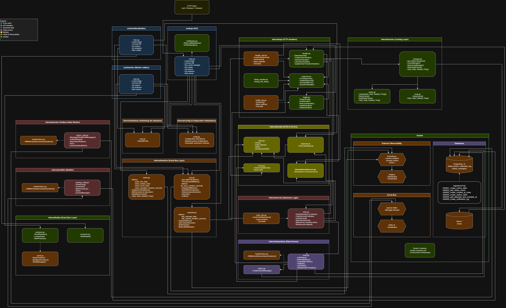
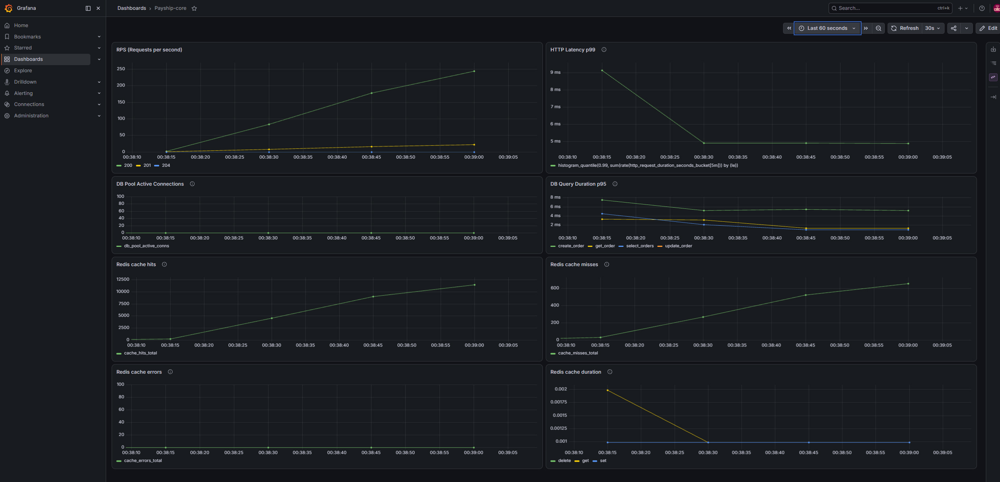
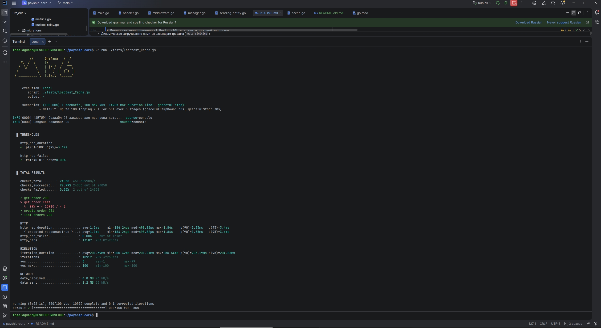

# Payship Core

**Payship Core** - это распределенная система обработки заказов маркетплейса с высокой гарантией доставки и консистентностью данных. Проект спроектирован по принципам чистой архитектуры (Clean Architecture) и ориентирован на отказоустойчивость инфраструктуры при сбоях.

Главная цель проекта - реализовать надежное взаимодействие между компонентами (API, фоновые воркеры, уведомления) и обеспечить стабильность системы даже в случае падения смежных сервисов (например, кэша).

---

## 🔥 Ключевые инженерные решения проекта

При проектировании сервиса фокус был сделан на надежность и предсказуемость поведения системы в production-окружении:

*   **Динамическое управление кэшем и защита БД:** В систему встроен кастомный менеджер кэша (`CacheManager`). Он постоянно проверяет здоровье Redis. Если Redis падает, менеджер на лету переключает приложение на безопасную заглушку (`NoopCache`), чтобы запросы шли напрямую в PostgreSQL. При этом автоматически срабатывает триггер на закручивание лимитов (`rate.Limiter`) - входящий трафик режется, отдавая клиентам `429 Too Many Requests`, что спасает основную базу данных от перегрузки.
*   **Гарантия доставки событий (Outbox Pattern):** При создании заказа данные о нем и событие для брокера сохраняются в базу данных атомарно, строго в рамках одной транзакции PostgreSQL. Это исключает ситуацию, когда заказ создан, а событие из-за сбоя сети потерялось. Независимый фоновый воркер (`Worker`) подхватывает эти записи и отправляет их в Apache Kafka.
*   **Идемпотентность обработчиков событий:** Сервис уведомлений (`Notifier`) защищен от дубликатов сообщений из брокера. Перед отправкой уведомления система проверяет и фиксирует факт отправки в таблице логов. Если брокер прислал сообщение повторно, система просто пропускает его.
*   **Безопасная работа с пулом соединений базы:** Для работы с PostgreSQL выбран драйвер `pgxpool` (v5). Чтобы избежать утечки коннектов при отмене контекста со стороны клиента, логика отката транзакций (`tx.Rollback`) вынесена в `defer` с использованием изолированного контекста и жесткого таймаута.
*   **Чистое разделение ответственности:** Логика приложения строго изолирована по слоям. HTTP-хендлеры (`internal/api`) отвечают только за транспорт и валидацию входных данных, бизнес-логика сосредоточена в `internal/service`, а вся работа с данными инкапсулирована в `internal/repository`. Слои связаны через интерфейсы, что позволяет легко тестировать их независимо друг от друга.

---

##  Стэк

*   **Язык разработки:** Go 1.26.0.
*   **База данных:** PostgreSQL 15 (Alpine).
*   **Брокер сообщений:** Apache Kafka.
*   **Кэширование:** Redis (интегрирован в общую цепочку с автоматическим фолбеком).
*   **Наблюдаемость (Observability):** Prometheus (сбор метрик пула БД, HTTP-запросов и кэша), Grafana (визуализация стабильности системы).
*   **Тестирование** Unit testing, K6 Load Testing
*   **Конфигурация:** Чтение параметров из `.env` файлов с помощью `godotenv` и кастомный парсер конфигурации с валидацией типов и дефолтными значениями.
*   **Инфраструктура:** Docker Compose v2(автоматический запуск приложения, баз данных и систем мониторинга с автоматическим применением миграций).

---

## 📐 Архитектурная схема системы

Ниже представлена актуальная схема взаимодействия компонентов. Система разделена на изолированные инстансы (API, Worker, Notifier), которые общаются между собой асинхронно через брокер сообщений и синхронно через базу данных, используя кэширование и защитные лимитеры трафика.



---

## 📁 Структура каталогов проекта

Проект организован по слоистой структуре, где каждый пакет имеет строго определенную зону ответственности, а зависимости направлены только сверху вниз (через интерфейсы):

```text
.
├── cmd/
│   ├── api/          # Точка входа для HTTP-сервера (прием заказов, метрики, хендлеры)
│   ├── worker/       # Фоновый процесс Outbox Worker (перенос событий из Postgres в Kafka)
│   └── notifier/     # Фоновый процесс Notifier (обработка событий из Kafka, отправка уведомлений)
│
├── internal/
│   ├── config/       # Инициализация конфигурации, парсинг .env и валидация типов параметров
│   ├── api/          # Транспортный слой (HTTP-хендлеры, middleware лимитера, валидация JSON)
│   ├── service/      # Слой бизнес-логики (валидация бизнес-правил, координация репозиториев)
│   ├── repository/   # Слой работы с данными (PostgreSQL, Redis, методы очистки кэша при мутациях)
│   ├── model/        # Слой описания моделей заказа
│   ├── kafka/        # Слой работы инициализации Kafka (consumer, producer)
│   └── metrics/      # Логика инициализации и регистрации кастомных метрик Prometheus
│
├── docs/             # Документация проекта (API спецификация, архитектурная схема)
├── migrations/       # SQL-миграции для PostgreSQL (структура таблиц, индексы, логи outbox)
├── grafana/          # Файлы конфигурации и кастомные дашборды для мониторинга
├── tests/            # Нагрузочные тесты и сценарии производительности на k6
├── docker-compose.yml# Манифест для локального развертывания всего окружения в один клик
└── prometheus.yml    # Конфигурация сбора метрик с сервисов приложения
```

### Направление потоков данных (Data Flow)

1. **Запрос:** Клиент отправляет запрос ➡️ `internal/api` (парсинг и проверка лимитов) ➡️ `internal/service` (бизнес-валидация) ➡️ `internal/repository` (работа с БД/Кэшем).
2. **Связь через интерфейсы:** Верхние слои ничего не знают о реализации нижних. Например, слой `service` знает только интерфейс репозитория. Это позволяет легко подменить реальную БД на моки при тестировании.
3. **Мутация данных и Кэш:** При создании или обновлении заказа через `repository`, система автоматически инвалидирует (очищает) связанный кэш (например, кэш первой страницы списка заказов или кэш конкретного заказа по ID), чтобы клиенты всегда видели актуальные данные.

---

## 🔌 API Эндпоинты

В системе разделены основные бизнес-маршруты и служебные эндпоинты для проверки работоспособности (Healthchecks) и сбора метрик.

### Бизнес-логика (REST API)

| Метод | Путь | Описание                                              | Логика работы с кэшем |
| :--- | :--- |:------------------------------------------------------| :--- |
| **POST** | `/order` | [Создание нового заказа](docs/api.md#post-order)      | Атомарная запись заказа + Outbox события. Очистка кэша первой страницы списка. |
| **GET** | `/order/{id}` | [Получение заказа по ID](docs/api.md#get-order-id)    | Запрос идет в кэш Redis. При промахе (miss) - запрос в БД и запись в кэш. |
| **GET** | `/orders` | [Список заказов с пагинацией](docs/api.md#get-orders) | Кэширование популярных страниц (например, первой страницы на 10 элементов). |
| **POST** | `/order/{id}/transitions` | [Смена статуса заказа](docs/api.md#post-order-id-transitions)                                | Обновление статуса в БД + инвалидация (удаление) кэша для этого заказа. |

### Служебные маршруты (Health & Metrics)

| Метод | Путь | Описание                                                                                          |
| :--- | :--- |:--------------------------------------------------------------------------------------------------|
| **GET** | `/health` | [Проверка доступности самого API (Health Check)](docs/api.md#get-health)                          |
| **GET** | `/ready` | [Проверка готовности системы (успешное подключение к PostgreSQL)](docs/api.md#get-ready)          |
| **GET** | `/metrics` | [Экспорт системных и кастомных метрик для Prometheus](docs/api.md#get-metrics)                    |

---

## 📊 Наблюдаемость и Мониторинг (Observability)

Приложение собирает подробную телеметрию, которая позволяет в реальном времени отслеживать производительность базы данных, эффективность кэширования и сетевую нагрузку.

### Ключевые метрики системы

1. **Метрики базы данных (PostgreSQL):**
    * `db_pool_active_conns` - Количество активных (занятых в данный момент) соединений с БД.
    * `db_pool_wait_total` - Очередь запросов, ожидающих освобождения коннекта из пула. Критический маркер для фиксации нехватки ресурсов.
    * `db_query_duration_seconds` - Время выполнения SQL-запросов (помогает отлавливать медленные выборки).
2. **Метрики кэширования (Redis):**
    * Статистика попаданий/промахов (`cache_hits_total` / `cache_misses_total`), позволяющая оценить эффективность стратегии кэширования.
    * Общее количество ошибок инфраструктуры кэширования `cache_errors_total`, например, тайм-аут Redis.
    * Длительность операций с кэшем в секундах `cache_operation_duration_seconds`.
3. **Метрики HTTP-слоя:**
    * `http_requests_total` - Общее количество входящих запросов с разделением по кодам ответов (включая `429 Too Many Requests` при срабатывании лимитера).
    * `http_request_duration_seconds` - Время обработки запросов сервером.

### Визуализация в Grafana

В репозитории подготовлены кастомные дашборды (`./grafana/dashboards/`), которые автоматически импортируются при запуске инфраструктуры. Они позволяют наглядно увидеть:
* Момент отказа Redis и автоматический переход на `NoopCache`.
* Динамическое закручивание лимитов входящего трафика (`Rate Limiting`).
* Поведение пула соединений PostgreSQL в моменты пиковой нагрузки.



---

## 📦 Локальное развертывание и Быстрый старт

Инфраструктура полностью контейнеризирована, сервисы запускаются автоматически с соблюдением порядка инициализации.

### 1. Запуск окружения
```bash
git clone https://github.com/ThisIsTheOldGuard/payship-core
cd payship-core
mv .env.example .env
go mod download
docker compose up -d
docker compose ps
```

### 2. Верификация и Локальный доступ
Получить адрес localhost при работе с WSL/VPN (`hostname -I | awk '{print $1}'`)
* **REST API:** `http://localhost:8080`
* **Worker:** `http://localhost:8081`
* **Notifier:** `http://localhost:8082`
* **Prometheus:** `http://localhost:9090` (`/targets`)
* **Grafana:** `http://localhost:3000` (`admin / admin`)
* **Apache Kafka:** `http://localhost:8090`
* **PostgreSQL** `http://localhost:5432` (`admin / admin`)
* **Redis** `http://localhost:6379` ([Redis Insight](https://redis.io/insight/))

Проверка базы данных и метрик:
```bash
docker exec -it payship-db psql -U admin -d payship_core
curl -s http://localhost:8080/metrics | grep db_pool
```

---

## 🧪 Тестирование и Нагрузка

### 1. Юнит-тестирование
```bash
go test ./internal/service -cover
go test ./internal/api -coverprofile=coverage.out
go tool cover -html=coverage.out -o coverage.html
```

### 2. Нагрузочное тестирование
```bash
k6 run ./tests/loadtest.js
k6 run ./tests/loadtest_Cache.js
```
<details>
  <summary>Скриншот</summary>



</details>

